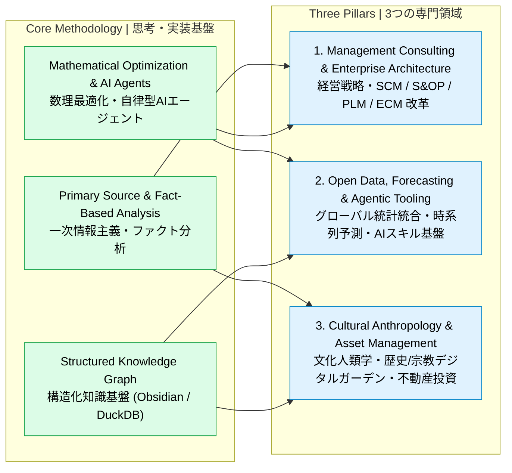

# Masashi Iida | 飯田 昌司

**Management Consultant / AI & Mathematical Optimization Architect / Cultural Anthropologist / Real Estate Investor**  
**経営コンサルタント / AI・数理最適化アーキテクト / 文化人類学者 / 不動産オーナー・投資家**

---

## Executive Profile | プロフィール概要

一次情報主義（官公庁統計・IR/財務データ・原典史料・実測データ）と数理モデル・AIエージェント技術を融合し、**経営戦略・サプライチェーン改革（SCM/S&OP）・エンジニアリングチェーン改革（PLM/ECM）から人文・歴史・宗教研究まで**を横断するマルチドメイン・アーキテクト。

コンサルティングにおける戦略構想にとどまらず、Rust / Python / TypeScript を用いた数理最適化エンジン・エンタープライズ業務基盤のフルスタック実装、および Obsidian + Quartz によるデジタルガーデン（知識グラフ）の構築・公開を行っています。

---

## Core Focus Areas | 専門領域

### 1. Management Consulting & Enterprise Systems (SCM / S&OP / PLM / CRM)
製造業・消費財（CPG）・プロセス産業を中心に、経営管理（FP&A / ROIC）・サプライチェーン計画（S&OP / PSI / MEIO）・製品ライフサイクル管理（PLM / LIMS）の業務設計からソフトウェア実装までを一気通貫で推進。

### 2. Mathematical Optimization, Time-Series Forecasting & Agentic AI
線形計画法（LP / MILP）による多期間サプライチェーン最適化ソルバー（Rust / Clarabel, Python / HiGHS）、統計・機械学習による需要予測・コモディティ価格構造方程式モデル、および Claude Code / Gemini CLI 向けの専門エージェントスキル群を開発。

### 3. Cultural Anthropology, Digital Gardens & Real Estate Investment
文献史学・民俗学・宗教学・考古学の一次史料に基づく比較研究をデジタルガーデン（Quartz + Obsidian）として体系化・公開。実物資産（不動産）のオーナーシップおよび長期投資を実践。

---

## Open Source & Public Projects | 公開リポジトリ・デジタルガーデン

### Mathematical Optimization, Data & AI Agent Tooling

| Repository | Category | Tech Stack | Overview |
| :--- | :--- | :--- | :--- |
| [**scm-lp-optimizer**](https://github.com/iida-masashi/scm-lp-optimizer) | Supply Chain LP Solver | `Rust` `Clarabel` `Cloud Run` | 多期間・能力制約付きサプライチェーン線形計画（LP）最適化エンジン。Pure Rust 実装の CLI および Cloud Run HTTP サーバー。 |
| [**opendata-skill**](https://github.com/iida-masashi/opendata-skill) | Global Open Data Hub | `Python` `REST API` | SCM・マーケティング・マクロ経済分析のための44以上の一次統計・オープンデータ統合取得基盤（e-Stat, FRED, OECD, UN Comtrade, EDINET, Open-Meteo, GDELT, AIS 等）。 |
| [**skills**](https://github.com/iida-masashi/skills) | Agentic AI Skills | `Python` `Markdown` `MCP` | Claude Code および Gemini CLI 向けのカスタムエージェントスキル・コレクション（経営分析、統計検証、ドキュメント監査、ワークフロー自動化）。 |
| [**convMD**](https://github.com/iida-masashi/convMD) | Document Pipeline | `Python` | PDF・Office文書（Word/Excel/PowerPoint）・Web等の多様なフォーマットを構造化 Markdown に変換するデータ前処理ツール。 |
| [**darts**](https://github.com/iida-masashi/darts) | Time-Series Forecasting | `Python` | 時系列予測・異常検知ライブラリ（Fork / 検証・拡張用）。 |

### Cultural Anthropology & Historical Research (Digital Gardens)

| Project | Live Site | Repository | Overview |
| :--- | :--- | :--- | :--- |
| **阿波説デジタルガーデン** *(Awa-setsu Digital Garden)* | [**Live Site**](https://iida-masashi.github.io/awa-garden/) | [**awa-garden**](https://github.com/iida-masashi/awa-garden) | 記紀・風土記・延喜式式内社・考古学資料等の一次史料に基づく古代史・阿波説の体系的検証デジタルガーデン（Quartz + Obsidian）。 |
| **日本の新宗教研究デジタルガーデン** *(New Religions in Japan)* | [**Live Site**](https://iida-masashi.github.io/religion-garden/) | [**religion-garden**](https://github.com/iida-masashi/religion-garden) | 幕末〜近代・現代に至る日本の新宗教の系譜・教義構造・社会人類学的背景を構造化した研究デジタルガーデン。 |

---

## Enterprise R&D Suites (Private Repositories) | 主要R&Dプロダクト（非公開）

コンサルティング実務およびR&D検証向けに開発・運用しているプライベート・エンタープライズ基盤群です。

| Product | Domain | Architecture & Key Capabilities |
| :--- | :--- | :--- |
| **openSCM** | AI-Native Supply Chain Planning & S&OP Platform | `Python (FastAPI / DuckDB / Polars / HiGHS)` + `React (TypeScript / AG Grid)` 需要予測、階層型売上計画、多段階安全在庫（MEIO）、週次・日次MRP/PSI計画、LP最適化、シナリオ比較、およびSKU別・得意先/チャネル別P&L（FP&Aウォーターフォール）・ROIC/CCC経営分析を統合したS&OPプラットフォーム。 |
| **openPLM** | Process Manufacturing PLM, Recipe & LIMS | `TypeScript` / `Python` プロセス製造業（食品・飲料・化学・化粧品等）向けの配合レシピ管理、原料・製品規格書（Spec）、品質検査（LIMS）、設計変更管理（ECM）プラットフォーム。 |
| **openCRM** | Enterprise CRM & Sales Intelligence | `TypeScript` 法人営業パイプライン、アカウントプランニング、商談・案件インテリジェンス基盤。 |
| **TMS** | Transportation Management & Logistics Optimization | `Python` 輸配送ルート設計、積載効率・配車計画および物流コスト最適化システム。 |
| **ecm-maturity-evaluator** | Engineering Chain Maturity Assessment | `Python` `Google Cloud Run` `Gemini API` CPG・製造業向けエンジニアリングチェーン（ECM/PLM）成熟度診断Webアプリケーション。 |
| **commodity-equation-forecaster** | Econometric & Commodity Price Forecaster | `Python` 需給ファンダメンタルズ・マクロ経済指標・構造方程式に基づくコモディティ市況・原材料価格予測モデル。 |
| **ceramic-yield-analyzer** | Manufacturing Yield & Defect Factor Analyzer | `Python (Streamlit / Plotly / SciPy / Statsmodels)` セラミックス・プロセス製造における焼成歩留まりおよび不良要因の多変量統計解析ツール。 |
| **bizplan-evaluator & checker** | Executive Advisory & Deliverable QA | `Python` VC評価軸（5軸スコアリング）に基づく事業計画書・ピッチデック評価AI、およびコンサルティング成果物（`.pptx`/`.docx`/`.pdf`）のデリバリー前品質監査ツール。 |

---

## Tech Stack & Analytical Toolkit | 技術スタック

- **Languages**: Python, Rust, TypeScript / JavaScript, SQL
- **Data & Analytical Engines**: DuckDB, Polars, SciPy, Statsmodels, scikit-learn, Darts
- **Mathematical Optimization**: Clarabel (Rust), HiGHS / SciPy MILP & LP, Network Flow & Multi-Echelon Inventory Optimization (MEIO)
- **Backend & Cloud**: FastAPI, Node.js, Google Cloud (Cloud Run, Vertex AI / Gemini API), Docker, GitHub Actions
- **Frontend & Knowledge Publishing**: React, Vite, Tailwind CSS, AG Grid, Plotly, Streamlit, Quartz / Obsidian
